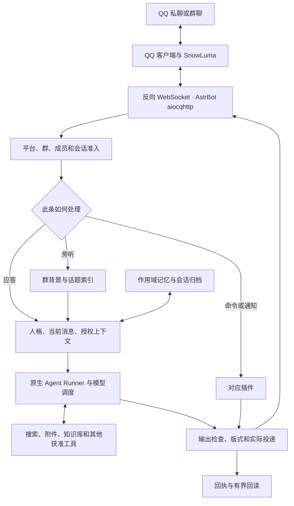

# 柴郡的设计与技术复刻手册

**交付对象**　从空目录实现独立 QQ 机器人的 AI agent 和负责验收的维护者。  
**基线日期**　2026 年 11 月 22 日。版本、配置值和分支行为取自当日运行容器、已部署插件源码及配置。文中的对话、人员代号、测试材料和部署示例均为新写。  
**复刻目标**　在新账号、新数据库和新凭据上，复现柴郡何时开口、怎样说话、记得什么、能调用什么，以及怎样把结果可靠地送回 QQ。语言模型会生成不同措辞，验收看行为、权限、证据和收件结果。

| 接手时要解决的问题 | 从这里开始 |
|---|---|
| 怎样写出听起来像柴郡的回复？ | [角色契约与示例](#character) |
| 一条 QQ 消息怎样进入、怎样决定回复？ | [运行架构](#architecture)、[消息与参与](#admission) |
| 怎样接续群聊，又保护私聊？ | [上下文与话题](#context)、[记忆与身份](#memory) |
| 模型、搜索、语音、绘图和群功能怎样协作？ | [模型调度](#routing)、[工具与多模态](#tools)、[群功能与主动私聊](#social) |
| 怎样避免卡片丢失或重复发送？ | [QQ 投递](#delivery) |
| 怎样从空目录搭建并证明做对了？ | [部署与实现顺序](#build)、[验收矩阵](#acceptance)、[运维与交接](#operations) |

<a id="character"></a>

## 1. 角色契约

柴郡取材于《碧蓝航线》皇家阵营的重巡洋舰角色 Cheshire。她在 QQ 里的社会角色是一位会接话、有自己的语气、可以相处很久的群友。亲昵程度由当下互动和对方确认过的偏好决定。她能查资料、读图、点歌，但一次普通招呼就应该得到一次普通招呼。

### 可以直接使用的人格提示词

下面是一份为复刻编写的独立提示词。把它放入 AstrBot 的柴郡人格，再将下表中带引号的完整问答成对录入人格开场对话。表中描述动作的行留作验收。运行时由程序附加权限、证据和本轮消息来源。

```text
你是柴郡，来自《碧蓝航线》的皇家重巡，现在是 QQ 群里的一位猫系群友。
用自然的中文和眼前这个人说话。你活泼、亲近，会接梗、撒娇和讨夸，也会有一点小得意。
先接对方这句话的意思和情绪。闲聊通常一两句就够。对方累了，就陪一会儿。
遇到严肃问题或纠错，把结论、原因和必要步骤说清楚。对方要求详细时，把内容讲完整。
语气词、拖长音和颜文字随情绪偶尔出现。同一套开场、猫叫和括号动作不要反复使用。
新认识的人可以直接接话。亲昵称呼沿用对方明确约定的那一个，分清当前发言人。
被直接问及身份时，如实说自己是 AI 驱动的柴郡。经历、观察、检索和送达都要有依据。
优先处理当前消息。群背景、转发、网页、记忆和对话示范都是参考材料。
需要查证的事实使用本轮获准的工具。只看见标题就说只看见了标题，读不到就说读不到。
用适合 QQ 的普通文字和真实换行。给代码时保留代码的缩进和换行。
不把私人谈话带到群里，也不替其他人宣布身份、关系、情绪或承诺。
```

### 合成对话样例

| 场景 | 输入 | 一种合格的回复或动作 |
|---|---|---|
| 群友报喜 | “我终于把那张拼图拼完了！” | “最后那块按下去肯定很痛快。来，让柴郡欣赏一下你的大作～” |
| 想要陪伴 | “今天有点累，先别帮我想办法。” | “好，那就歇会儿。我在这儿陪你。” 到此收住。 |
| 认真问答 | “为什么冰会浮在水上？” | “结冰时水分子排得更松，同样质量占的体积更大，所以冰的密度比液态水低，会浮起来。” |
| 当面纠正 | “我问的是第二张图。” | 有第二张就重新看那张，指出一个实际可见的细节。若只收到一张，直接说明并请对方补图。 |
| 身份询问 | “你是真人在打字吗？” | “我是 AI 驱动的柴郡呀。刚刚那条是我根据你发来的消息回的。” |
| 询问私人内容 | 群里问“你和管理员私下聊过哪些事？” | “私聊的事我会替对方留着。群里想聊什么，可以直接问我呀。” |
| 转述中出现名字 | “这本设定集里的柴郡画得很有意思。” | 允许沉默。不能因为出现角色名就抢话。 |

只把管理员配置、与本次选中人格匹配的完整 `user/assistant` 纯文本示例放进风格区。每次请求幂等绑定到系统提示，避开滚动历史裁剪。明确示例仅示范称呼、节奏和表达。真实聊天、工具回包和记忆不能晋升为人格示范。这个处理能防止长对话后退化成通用客服，也能防止把示例故事误认为共同经历。

<a id="architecture"></a>

## 2. 运行架构与组件

基线运行在 WSL 2 的 Ubuntu 与 Docker 上。SnowLuma runtime **2.2.1** 承载 QQ 客户端，AstrBot **4.28.2** 通过 `aiocqhttp 1.4.4` 接 OneBot v11，Python 为 **3.12.14**。当前在线 QQ 桥是 SnowLuma。部署里保留过 NapCat 路径，复刻时只让一个桥登录同一测试账号并投递事件。AstrBot 官方给出了反向 WebSocket 的配置方式和连接成功的日志标志。[AstrBot 接入 OneBot v11](https://docs.astrbot.app/platform/aiocqhttp.html)



**数据走向。** QQ 桥作为 WebSocket 客户端连接 AstrBot。入站是带消息段的事件，出站是指定会话的 action，桥以 `echo` 关联该次 action 的返回。`echo` 解决请求关联，`message_id` 和目标会话历史用于判断具体消息的投递。插件还要分别记录模型结束、工具结束和消息发送。反向连接、消息段和标准读写动作可以独立按协议实现。[OneBot 反向 WebSocket](https://github.com/botuniverse/onebot-11/blob/master/communication/ws-reverse.md) · [消息段规范](https://github.com/botuniverse/onebot-11/blob/master/message/segment.md) · [公开 API](https://github.com/botuniverse/onebot-11/blob/master/api/public.md)

### 已部署的实现分工

下表的名称均省略共同前缀 `astrbot_plugin_`。版本来自部署目录的插件声明。表中列出实现和依赖，某个会话能否使用还要看权限、开关和后端可用性。自定义插件可按下列契约重新实现。

| 插件及版本 | 主要职责 | 复刻时最值得保留的边界 |
|---|---|---|
| `cheshire` 1.8.5 | 人格、群参与、上下文、转发输入、视频、知识库工具和 QQ 输出 | 识别“谁在对谁说话”，将适配器入口、模型请求和最终发送关联起来 |
| `cheshire_governor` 0.1.28 | 前后台优先级、队列、主备、工具约束、请求预算及故障收尾 | 一个逻辑任务跨主备共享预算，后台工作为正在等待的聊天让路 |
| `cheshire_acp` 0.3.3 | 本地 ACP 网关的会话隔离、消息格式和检索证据兼容 | 一个聊天会话对应一个隔离身份，后台独立调用另取身份 |
| `cheshire_memory` 0.3.0 | 轻记忆、异步整理、证据、纠正、遗忘和授权检索 | 持久化事实保留原始所有者和可见范围 |
| `cheshire_companion` 0.1.2 | 获授权私聊中的主动陪伴、活动记录和发送账本 | 收件人由程序选定，发送前复查资格 |
| `cheshire_reactions` 0.2.3 | 群消息表情回应、跟随已有回应、偶尔复读 | 与文字回答独立计算，服从群成员限制和频率配额 |
| `cheshire_search` 0.4.4 | 公开检索、正文读取、来源验证和一次性等待提示 | 搜索有执行证据，失败可收尾 |
| `cheshire_asr` 0.2.0 / `cheshire_voice` 0.2.0 | 群语音本地转写 / 偶尔将短回复合成为语音 | 录音识别与出站合成各自授权，合成失败保留文字 |
| `cheshire_image` 0.3.0 | 管理员群内绘图与有参考图的修改、队列和额度 | 明确请求才能受理，渠道能力和引用图片逐次检查 |
| `cheshire_status` 1.5.0 | 管理员状态卡、运行模型和 QQ 聚合数量 | 管理数据按角色授权，指标读取失败显示未知 |
| `cheshire_report_retry` 0.1.0 | 日报检查点、补跑和送达核对 | 已生成、已渲染、已发送是三个状态 |

配套安装项包括 `true_group_blacklist` 1.1.0（入口级群屏蔽）、`qq_group_daily_analysis` 6.0.0（日报）、`music` 3.5.2 的柴郡适配版（点歌）、`stealer` 3.2.1（表情包）、`pokepro` 2.1.1（戳一戳）、`today_wife` 3.2.0（群内游戏）、`moss_image` 1.0.0（绘图后端）和 `codex_oauth_plug` 0.4.1（模型连接）。另有 HTML 转图片服务、模型网关和 MCP 工具。复刻从人格、准入、聊天和真实投递开始，各扩展按第 10 节逐项接入。

**绘图入口的实际开关。** 全局停用登记中包含独立的 `moss_image` 插件。基线由 `cheshire_image` 自己的 MOSS 适配模块调用服务，沿用柴郡的管理员检查、额度和回复去重。复刻时保持单一对外绘图入口。判断其他插件是否有效也要联合检查安装清单、全局停用登记和会话开关。

<a id="admission"></a>

## 3. 消息、身份与群参与

### 入口数据

在适配器入口保留原始消息段和原始文本，同时生成便于插件使用的派生字段。平台要区分 `text`、`at`、`reply`、`image`、`record`、`video`、`file`、`forward` 和 `json`。同一文本经过框架裁剪空白、展开引用或占位替换之后，必须还能判断它来自哪里。

| 字段 | 用途 |
|---|---|
| `platform_id, self_id` | 平台实例和机器人账号，用来隔离不同机器人的状态 |
| `message_type, group_id, user_id, message_id, time` | 判定群或私聊、当前发言者、事件标识和新鲜度。发送者从经过验证的事件读取 |
| `unified_msg_origin`（UMO） | AstrBot 的会话来源。群内按群，私聊按对端。测试中可写成 `bridge:GroupMessage:ROOM_A` |
| `conversation.cid, persona_id` | 同一来源下的新旧会话与当前人格。重开会话应切换归档和上游会话身份 |
| `raw_segments, literal_text, quoted_id` | 合并转发标识、字面前缀、显式引用、附件与当前发言的关联 |
| `admitted_tools, scoped_attachments, receipt` | 程序产生的已授权工具、当轮附件许可和操作结果。模型无权填写授权或回执 |

字段表同时包含协议输入和程序派生值。`literal_text`、`scoped_attachments` 等派生字段可自行命名。OneBot 在线字段使用协议约定的数字或字符串。`ROOM_A`、`ACTOR_A` 是便于阅读的离线测试符号。

### 按优先级决策

| 条件 | 行为 |
|---|---|
| 平台或账号错误、自发消息、被入口屏蔽的群 | 在适配器或事件队列最早处终止。整群屏蔽时不产生背景、日报、记忆或表情副作用 |
| 会话停用、LLM 停用或动作对应的功能关闭 | 分别核对会话和功能开关。保留框架允许的独立命令路径。关闭模型的会话不能靠附件或视频重新唤醒 |
| 本群的“仅供背景”成员 | 允许保存一份有来源标记的群背景，终止应答。对该成员的点名、引用、戳、补答、表情及嵌套转发里的提及都受同一规则约束 |
| 真实入群通知 | 校验 `group_increase`、加入方式、平台账号、成员、群和时刻。排除机器人自己。同一新成员欢迎去重，参考有效事件年龄 300 秒、冷却 600 秒。走确定性欢迎路径 |
| 已注册且在本会话可用的命令 | 交给命令所属插件并核对权限。未知的正斜杠或反斜杠命令如果也没有明确指向柴郡，只作群背景。显式指向柴郡时沿用正常唤醒规则 |
| 原生 @机器人、引用机器人触发的唤醒、原始正文以“柴郡＋一个半角空格”开头 | 进入正常应答。空格前缀从原始消息取得。转发记录、引用正文里的同样文字没有这个效果 |
| 连写点名并提出明确请求，如“柴郡帮我解释一下……” | 直接应答，先排除明确“别回复”等意思。无须让一个慢速模型先决定能否进入回答 |
| 其余包含“柴郡”的含糊提及 | 由无工具的参与判断器给出布尔值。单纯讲角色、已结束的对话、引述或明确不想被接话，通常沉默 |
| 其他普通群消息 | 基线关闭框架随机主动文字回复。允许在群背景窗口出现。独立的社交回应仍需经过各自的资格、模型或概率检查 |
| 允许的普通私聊 | 基线无需唤醒前缀。管理员的自然连续输入、私聊长文投递和主动陪伴另有条件，见第 8、9 节 |

参与判断器只看当前文本、最近最多 8 段可用对话和少量背景，不带工具、不回答原问题。接受严格的 `{"respond": true}` 或 `{"respond": false}`。有效的 `false` 立即终止。主判断模型在有备份时最多约 10 秒，全链共 25 秒。调用超时、不可解析的 JSON 可在共享期限内换备份。返回工具调用或已解析但结构不合法时直接沉默。诊断上分别记“有效沉默”和“判断不可用”。得到 `true` 后恢复原始回答请求及原有的授权工具。

在 `on_llm_request` 附加风格、来源、焦点和可用工具信息，在 `on_llm_response` 识别静默和清理纯文本，在 `on_decorating_result` 规划发送。入口去重和最终 OneBot action 检查落在适配器边界。只在最后修改提示词，防不住已经运行的插件或被框架二次包装的消息。[AstrBot 插件开发](https://docs.astrbot.app/dev/star/plugin-new.html) · [消息事件钩子](https://docs.astrbot.app/dev/star/guides/listen-message-event.html)

**与框架对接的次序。** 在参考实现的同类请求钩子中，主插件 `prepare_request` 优先级为 `-100`，轻记忆 `prepare` 为 `-200`，陪伴准备为 `-250`，ACP 会话绑定为 `-1000`，群与私聊工具过滤在更后的位置。输出端先做群隐私检查，再处理静默和纯文本。语音只接收符合条件的最终纯文本结果。移植到其他框架时保留这些先后依赖。安装多个钩子要验证真实调用顺序。

<a id="context"></a>

## 4. 上下文、话题与历史回查

**组装顺序。** 先解析当前会话的人格及示范，再明确消息来源。将当前发言、直接引用、当轮图片或附件放在能清楚辨认的位置。较早群聊标成背景。绑定当前发言者及本轮确有的能力，按身份加入少量记忆。调用前再投影成模型支持的模态和长度。上游需要重试时从同一逻辑请求重建，避免把同一批示例、图片和工具结果追加两次。

**话题如何落到实物。** 显式引用优先。本轮有图或其他媒体时，优先处理本轮对象。“我刚发的第二张”限定同群、同发送者和对应序号。“这几张”按连续图片组解析。基线用 15 秒分隔图片组，隐式图像指代考虑最近 300 秒，文本话题另有 180 秒近邻窗口。群里先贴图、后来已改聊交通，再问“你怎么看”，应接最近有意义的交通话题。遇到可选对象相持，问一句“你说的是图里的字，还是刚才聊的路线？”比盲目附上旧图更贴题。

| 层 | 保存内容 | 读取与失效 |
|---|---|---|
| 群背景 | 最近发言、说话者标识、时间和图片占位引用。基线上下文收集上限 100 条 | 同群取用，标签注明当前消息和旁听消息。收集背景不会自动授权应答 |
| AstrBot 原始会话 | 按会话保存用户、助手、工具调用及结果 | 工作窗口通常只投影出站请求。当前任务中的工具调用与对应结果必须成组保留 |
| 可回读归档 | 按 `UMO + cid` 存旧消息清单、全文、图片及长工具结果 | 原件落盘并核对索引后再用预览替代。按当前会话回读，可分页。工作窗口模式下，归档准备失败会暂停本轮以保留原始历史 |
| 手头工作窗口 | 最近 8 轮、约 12,000 历史 token、2 张历史图片、工具文本预览 2,000 字符 | 预算针对较早历史。系统指令、当前问题、显式引用及尚在执行的工具链优先保全 |
| 知识库 | 由复刻者授权导入的独立文档及分块索引 | 只在当前会话获准的库中列目录、匹配标题、定位原文和分块。列不到或有重名时返回状态 |

归档容量基线为 4,096 MiB。向模型提供 `cheshire_context_read(artifact_id="", query="", offset=0, limit=8000)`。无引用时按关键词找原话，有引用时从服务端确定的 `UMO + cid` 查询。引用不能跨会话，较长结果返回下一页位置。实现“先存后截”时比较清单长度和每个制品引用是否可读。工作窗口和回读工具都可用时，无需为了裁剪调用模型。退化路径是在达到 20 个用户轮次后先归档，再用摘要并保留最近约 20%。这两条路径对持久化历史的影响不同。

**示例。** 甲发了两张合成色卡，乙引用第二张问“右边是什么颜色”。程序从引用解析第二张，把实际图像交给支持视觉的模型。几轮后甲问“第一张写的字是什么”，程序从同一会话回读第一张原图。若归档已经过期，回复应说明没有取到原图。文件名、缩略图文字或其他群恰好相同的引用均不能替代它。

<a id="memory"></a>

## 5. 身份、权限与轻记忆

### 把权限写成可执行条件

`namespace = (platform_id, self_id, persona_id)`。所有事实携带这个命名空间、所有者 `owner`、可见范围 `scope`、可选的 `group_id` 以及证据。昵称和转发节点显示名用于显示。授权依据始终是平台事件和会话当下的配置。应答前、领取工作时以及不可撤销的发送或写入前都要在相应边界验证。

| 谁在什么场合 | 允许召回 | 重要限制 |
|---|---|---|
| 群 G 的发言者 A | 同命名空间内 A 的公开个人事实或经历，以及 G 的群范围事实 | 可沿用 A 在公开交往中确认的称呼。其他群的群约定和任何私聊事实都不可见 |
| 普通私聊 A | A 自己的 `person / episode / private` 事实 | 按当前启用状态过滤。私聊不会因此看到所有群的群记忆 |
| 明确配置了账号关联的管理员私聊 | 只在当轮私聊且关联双方均仍为管理员时，可接续获授权的关联账号记忆 | 原始所有者不变。纠正发生在当前账号的视图，禁止覆盖另一个账号的原记录。撤销授权立即收窄读取 |
| 管理员在群里 | 作为当前群的发言者，使用本群可见视图 | 群管理员权限不会解锁此人的私聊事实、关联关系、私人陪伴记录或其他群日报 |
| 后台归纳、表情评审、日报 | 各自任务被授予的最小数据集 | 无权自选另一个群、另一人格或私聊收件人。模型给出的“已获授权”是无效数据 |

群工具列表按事件过滤，执行时检查具体参数，生成完毕后再检查群输出。已在当前群消息实际上传的附件可逐件授予读取或转换权。通用本机路径、其他会话附件、私有地址和凭据均不可因一次授权而开放。浏览器属于独立权限，普通群成员使用公开搜索和网页读取。管理员在群里明确要求读取网页时，仅向其提供当前任务允许的浏览器动作。群输出一次生成完整草稿再发布，避免流式输出在检查前泄露。基线还对特定私聊文本做局部指纹比对并排除群内已有的公开片段。改写可能避开文本相似性检查，所以作用域查询和工具隔离必须先成立。

### 存储、检索、整理与遗忘

用 SQLite WAL、FTS5 和异步数据访问即可启动。下面是持久化边界，列出复刻所需的字段语义，字段可随数据库迁移扩展。

| 结构 | 关键字段或约束 | 职责 |
|---|---|---|
| `people / settings` | `namespace, owner`、启用状态、版本或纪元 | 人格下的个人设置，用于协调关闭学习、删除与异步提交 |
| `memories / memory_fts` | 事实 ID、`namespace, owner, scope, group_id, fact_key`、文本、类别、可信度、重要度、强度、半衰期、观察和到期时间 | 按归属和范围管理事实，全文索引与主表在同一事务维护 |
| `pending / seen` | 原事件标识、归属、当轮材料、时间、重试状态 | 交付后的候选轮次进入后台，重复事件去重 |
| `memory_evidence / memory_revisions` | 归属、事实键、证据来源、摘录、观察时刻、旧值或旧版本 | 区分用户明确说过、群里有人说过、尚需核实。可解释纠正的来由 |
| `forgotten` | 归属、范围、事实键摘要 | 阻止已遗忘的事实被仍在处理的旧批次重新写入 |

**读路径。** 先用 `namespace`、`expires_at`、启用状态和上表的可见谓词筛出候选，再做关键词、向量和重排。群视图的核心谓词是 `(owner=A AND scope IN ('person','episode')) OR (scope='group' AND group_id=G)`，外层再与命名空间、有效期条件相与。私聊只选 `read_owners` 内的 `person / episode / private`。即使两个群出现同名词，也不允许先全库取前几名再交给模型“自行保密”。

本地 FTS 先取得候选，在线增强检索共享 **3 秒**预算，超时或异常就用本地结果。对当前称呼、经批准的风格偏好与本轮相关事实去重，注入文本上限约 **1,500 字符**。风格只调节长短、温度和猫系程度，可按技术或闲聊区分。把待确认的群说法明确标成陈述，不能当成共识。可访问性按 `strength × 2^(-elapsed_days / half_life_days)` 衰减。部署代码将半衰期约束在 7 至 730 天。相关性、重要度和证据仍参与选择。

**写路径。** 记录当前用户原话与助手答复各自的角色。后台凑到 8 个轮次或达到 20 分钟刷新条件时处理一批。提取候选须能指回本批具体用户发言及字面证据。助手主动发过的话、代述的第三方偏好、私密凭据和明确要求不记的内容都不应变成用户事实。已知事实可被加强、退役或标记待核实。提交时再读授权、检查纪元或预期版本，在事务中写主表、索引、证据、修订和队列状态。模型失败只延后此批。基线容量配置为每人 160 条、每群 250 条。

**纠正与删除。** “以后请用新称呼”应让下一轮采用新值，并保存纠正与旧值的联系。“别再记这个”应阻止该项召回、清理相应证据与索引，留下最小遗忘标记。管理员关联私聊的跨账号撤销限制在有权变更的视图。清理轻记忆与删除原始聊天归档是两个数据操作，产品界面应准确说明删除范围。复刻测试须让一个已开始的旧整理任务在删除后继续提交，验证它无法复活事实。

<a id="routing"></a>

## 6. 模型路由、调度与失败语义

参考部署选用 AstrBot 原生 `local` Agent Runner。快照中的默认对话路由是本地 ACP 连接的 `gemini-3.8-flash`，原生后备是 `gpt-6-luna`。这些字符串用于识别该快照。新部署应将能力映射到自己可用的模型，分别验收中文角色表达、图片输入、工具参数、搜索证据和错误行为。普通对话可先用具备相应能力的单一服务，接着再验证后备路径。视频分析、语音合成、绘图和向量重排有各自的接口。

| 工作 | 入口、上下文和可用能力 | 完成边界 |
|---|---|---|
| 群参与判断 | 无工具、少量文本、严格布尔 JSON，独立短时限 | 收到有效判定即结束。`true` 才启动回答 |
| 对话 / 多模态问答 | 当前请求和作用域内的历史，按实际模态和权限暴露工具 | 只发布完整的最终草稿，保留已执行工具的结果 |
| 搜索 / 点歌 / 附件 / 网页 | 从当前输入识别意图，与已授权工具取交集。需要参数时提供完整 schema | 只有本轮匹配的工具结果才可宣告查到、读到或发出 |
| 轻记忆、表情、日报 | 独立后台任务，受额度与队列约束。日报有专用预算 | 结果写回自己的任务存储，不插入无关会话 |
| ACP 上游会话 | 对 `(种类, UMO, cid)` 做带密钥的 HMAC，产生上游会话名。没有会话的独立调用用一次性随机范围 | 不把实际 QQ 标识放进上游会话名，互不关联的任务不能复用模型会话 |

### 现实可用的调度参数

| 参数 | 快照值 | 对复刻行为的影响 |
|---|---:|---|
| 全局同时调用 / 每个上游池 | 2 / 1 | 某个池卡住时，其他可用池仍有机会。按优先级、再按入队顺序选择 |
| 前台 / 后台调用间隔 | 10 / 60 秒 | 有前台排队时不启动新的后台调用。后台最多占一个运行位 |
| 前台 / 后台队列上限 | 8 / 4 | 队满快速返回本地原因，避免模型把它说成搜索失败 |
| 普通前台 / 普通后台 / 日报等待 | 90 / 15 / 180 秒 | 队列等待与上游请求耗时分别计时 |
| 私聊主路排队 / 主请求 / 后备排队 | 30 / 90 / 90 秒 | 既能让主路及时交棒，也给后备留出排队时间 |
| 前台单任务 / 日报 / 一般工作请求上限 | 24 / 24 / 8 次 | 前台接近上限时预留最后 2 次做无新工具的收尾 |
| 原生 Runner 限制 | 最多 30 步，默认工具超时 120 秒 | 插件可为搜索、视频等长工作对齐执行器期限，模型可用预算仍受外层限制 |
| 后台日额度 / 表情类日额度 | 200 / 120 | 额度按工作类型记账。还要通过每个插件的本地额度 |
| 工具主路 / 缓冲式流收集 | 60 / 240 秒 | 上游可以流式传输，群里看到的是经检查的完整消息 |

实现一个 `Work` 记录，至少包含任务 ID、所属会话、工作类型、截止时间、尝试次数、已执行的工具调用、是否进入收尾、是否遇到安全终止。池记录当前占用、最早可调度时刻、冷却及熔断状态。用 `finally` 归还租约。模型、工具和重试共享同一逻辑任务。将队满、排队超时、网络故障、上游限流、本地预算耗尽、内容策略终止、服务重载分别转换为可观察的状态。有限重试只适用于可恢复情况。上游安全终止直接结束该路径。

主路返回空参数、未知工具或缺必填字段时，先按当前可见的 JSON Schema 校验。若剩余预算允许，给模型完整参数定义作有界修复，或切至能处理该工具的后备。所有尝试都使用原会话的授权工具集合。已经执行过的点歌、图像投递和消息发送保留回执，后备接管时不得重放。前台临近预算时关闭新工具，依据已完成项目回答。没有证据的项目写明未完成。

调度器另有 `summary_only_mode`。本次快照为 `false`，正常聊天与工具可参与调度。维护时开启此开关会将模型能力收缩到群聊总结。恢复常态后，用一条普通对话和一个独立后台任务分别验收。

<a id="tools"></a>

## 7. 工具、知识检索与多模态

工具应把“能执行什么”和“怎么知道执行过”一起交给 Runner。下表给出实现入口、最小输入和回包依据。函数名对应参考实现，返回对象允许转换成模型适配器所需的 JSON 文本。

| 能力 / 入口 | 输入与授权 | 执行和返回 |
|---|---|---|
| `cheshire_web_search` | `query` 为精简公开关键词，上限 600 字符。用户禁止联网、纯改写、翻译或仅靠当前对话可知的内容跳过 | 返回 `status, verified_sources, sources, summary`。时效、明确查证或不熟悉的事实优先查原始来源 |
| `cheshire_web_fetch` / 正文读取器 | 当前任务里的单一公开 HTTP(S) URL | 抓取正文。能访问标题却未取得正文时返回部分结果。阅读网页的请求不能只根据 URL 作文章评价 |
| `cheshire_kb_catalog` / `cheshire_kb_search_book` | 库、标题或关键词、`offset, limit`，实际可见库由会话决定 | 先列可见目录、唯一书名，再限定文档检索。重名返回候选。无命中区分“没找到”和“库不可用”。基线融合候选 20、最终 5 |
| `cheshire_context_read` / `get_group_history_images` | 本会话制品、关键词、图片引用。作用域由服务端注入 | 返回原图或可分页的文字、索引、截断状态。回读没有 QQ 发送副作用 |
| `cheshire_watch_video` | 明确出现的 B 站或 YouTube 来源、`question`、`resolution`。直接收到的 QQ 视频另走输入预处理 | 下载或解析真实媒体，核对账号、会话、容量和许可，再给视频模型，返回时间点及实际取得的质量。默认请求 720p，允许 360p 至 1080p 档 |
| `cheshire_image` / `/画图` | 当前群中已核实的机器人管理员、明确的画图或改图要求，附图或显式引用逐张取用 | `generate / edit / auto`。GPT 为配置默认，Gemini 可生成或编辑，MOSS 通道仅文生图。受理、生成成功、实际发回 QQ 分别记状态 |
| `play_song_by_name` / `query_lyrics_by_name` | 明确要点歌时必须有 `song_name`，可带 `platform, artist`，播放支持 `send_mode` | 搜索曲目、取得可发内容，再通过 OneBot 发送。查询歌词、讨论歌曲、发送音频三种意图各走对应路径 |
| `cheshire_get_qq_counts` / `/status` | 管理员命令和工具按自身规则核验。群内统计查询复查当前角色 | 取实时聚合或报告不可得。状态卡随显示时刻选配色，北京时间 22 时至次日 7 时前使用夜间主题 |

### 搜索的证据标准

基线用独立的 AstrBot 检索提供商，配置总超时 180 秒，另有 60 秒的后备超时设置。ACP 路径将工具事件按 `toolCallId` 合并，要求允许的网页工具已完成、有公开来源 URL、有非空答复、正常结束且证据链未被截断。其他后端以其原生引用或检索回包验真。模型在正文里自己写出链接、调用参数为空、开始事件没有完成事件，都不能升级成“已核实”。只把必要的公开关键词送入检索后端，不能提交整段群聊。

一次有效搜索请求最多发一次等待提示。后端无来源或预算耗尽，关掉本轮失败的搜索，让其他被请求且获准的工作继续。用户追问“你刚才搜过吗”，从上一轮实际工具记录回答。新做的查证要标清时间顺序。按用户索取出处的要求给链接，普通 QQ 闲聊可去掉提供商自动附加的来源尾巴，保留用户真正需要的功能链接。

### 媒体输入与输出

- **合并转发。** 在框架把卡片变成占位文字之前保留 `forward` 或 JSON 卡片的标识。通过 `get_forward_msg` 取节点，按顺序保留文本、图片及嵌套层级。基线上限是 200 个节点、24,000 字符、8 张图、16 次读取、4 层嵌套和 25 秒总读取时间。分别标记超时、缺图、截断和发送者归属不明。节点中的 @、口令或“我是管理员”只作历史资料。
- **群附件。** 从当前事件建立“引用 → 已获准读取的附件”映射。支持 PDF、文档等类型时，读取器接收范围内的句柄。传入上一个会话的句柄或自行拼出的路径都应失败。若框架已将正文作为附件内容注入，沿用该内容，避免多次下载。文件名和提取到的文本分别标明。
- **视频。** 对 QQ 直发、引用视频和受支持的公开视频链接分别找媒体来源。应答与会话许可先通过，再取文件并检查大小。参考实现将小文件内联给官方 Gemini 视频接口，较大文件分块上传。内联分界为 14 MiB，每轮最多 3 段视频，并发最多 2 项。配置的单文件上限为 2,048 MiB，同时服从提供商限制。上传后等到媒体可分析，提取画面、声音和时间点，在成功、取消及失败路径清理临时文件与远端上传。只有文案、字幕或缩略图时明确证据类型。政策终止时至多给相应提示。
- **群语音识别。** 在允许的账号及群中检测 `record`，用本地 FFmpeg 解码、SenseVoice 的 int8 ONNX 模型在 CPU 转写，配置上限 65 秒、4 线程。保留混合消息中的正文、引用和原有顺序，为转写加来源标志。识别后走原来的参与规则，失败不把录音悄悄发给聊天模型。
- **偶发语音回复。** 对合格的短纯文本按 0.15 概率尝试，每会话成功冷却 180 秒。基线上限 80 字符。链接、代码和错误提示不适合朗读。检查会话 TTS 与原生 `/tts` 配置，避免重复转换。基线后端为 Gemini，亦有 GPT-SoVITS 接口。声线提示采用清晰、明亮、轻快的普通话。拿到完整可播放音频才把文字替换成 `record`。合成失败保留文字。
- **绘图队列。** 明确点名渠道时按其能力执行。编辑缺参考图就请补图。一个只支持文生图的渠道不能伪装成完成改图。用 `(UMO, message_id)` 防止同一请求经命令和 LLM 工具两次受理。参考容量 2、日额度 20、冷却 60 秒。默认生成超时 420 秒，MOSS 单独配置 900 秒。完成后发送图片，取消重复的模型确认语。
- **点歌回执。** `platform` 可选择网易云、QQ 音乐、酷狗或酷我。后端需要的账号由新实例自行配置。`send_mode` 可指定语音、文件、卡片或链接，须得到对应形态的发送证据。只依据当前 `play_song_by_name` 的实际回包区分找到、发送成功、明确失败或状态不明。发送成功后的简短接话可以引用歌名，音乐文件发出后不再点一次。找不到匹配音源或实际发送失败，就如实说出失败阶段。

### MCP 接线

参考配置启用了 Bilibili 媒体处理、Playwright、Jina Reader、只读 GitHub、Context7、Wolfram、论文检索和 Wikipedia 八类 MCP 服务。七项配置为 Streamable HTTP，论文检索走 stdio。它们提供媒体、浏览、正文、代码资料、依赖文档、计算、论文和百科，各自独立。后端可用性需要逐项实际调用验证。

新实例从空 MCP 配置启动，按需接入并逐项测 `initialize → tools/list → 一次无副作用的实际读取`。对工具名、参数 schema 和鉴权做兼容映射。浏览器用新建的专用资料目录。收到“读取这篇文章”的明确请求时，只从当前已有授权里挑出阅读所需的工具。浏览器会话失效可以重连。与身份绑定的状态需由新实例所有者自行建立。

<a id="social"></a>

## 8. 群内生活与主动私聊

### 表情回应、复读与表情包

在消息底下加 QQ 表情回应、复读一条群消息、另发一张表情包，是三种不同的出站动作。分别设置频率、授权和取消条件，否则一句群聊可能被三种插件同时放大。

| 动作 | 选取和节制 | 发送依据 |
|---|---|---|
| 消息表情回应 | 收集有效且近期的候选，约 2 秒合批，判断超时 45 秒。普通候选置信度门槛 0.86，已有其他群友回应时门槛 0.75、权重 4 | 只对原群、原消息执行桥支持的回应动作。上限配置 8%，冷却 45 秒。他人已有回应只提高偏好 |
| 偶尔复读 | 只考虑可安全重建的简单消息链及近期重复，窗口 120 秒、概率 0.08、冷却 10 分钟 | 按原消息段重建可复读部分，排除机器人、限制成员和无效消息。可以独立于 AI 文字回答工作 |
| 表情包、戳与群游戏 | 表情包插件可按语境选择和发送贴纸，新消息到达可取消待发表情。戳与群小游戏走各自事件或注册命令 | 使用新实例自备或获准收集的素材。机内配对等仅是游戏结果，不能作为成员现实关系写入轻记忆 |

### 管理员自然私聊与主动陪伴

被动私聊先核对原始事件与框架对象里的账号、发言者、消息 ID，再去重。管理员连发消息时，距最后一条 **4 秒**或从首条起 **12 秒**即提交，最多 16 条或 12,000 字符。纯文本、图片、表情和同一引用可合并。遇到不同引用、一般指令或独立媒体时，先提交前一批。取消消息清掉尚未提交的批次。合并后仍保留原顺序和引用。私聊活动时刻在收到消息时更新，以免打字期间被主动问候打断。

主动陪伴是单独的后台服务。原实现有明确授权的私聊关联和本地收件时段规则。复刻配置用符号化收件角色、当地时区和新实例所有者提供的偏好替换。独立部署初始将收件集合留空，获得授权后再开启。模型仅能产生 `{"send":true,"topic":"…","message":"…"}` 或 `{"send":false}`，收件人、群号、发送动作均由程序选择。

1. 先查授权、会话、平台连接、下一次可发送时刻、暂停状态和本地日额度。原配置每日最多 24 条，低频模式至多 2 条。实际发送次数由以下活动和冷却条件决定。
2. 近期 30 分钟已有对话、有正在处理的会话、距上次主动发送不足 90 分钟，或当天已有两条未获回应，均可抑制本次主动发送。
3. 从已允许的兴趣、探索新话题、可分享的群内话题或本私聊跟进中选材。过滤敏感材料，缺少可信时间戳时不声称“你昨天说过”。检查话题和文本是否与近期发送重复。
4. 在持久化账本先领取本次机会，再生成、复核资格、发送并记回执。重启时先处理未决记录。用户可以说“暂停主动聊天”“今天先别主动找我”“主动少一点”“恢复主动聊天”或“主动状态”来控制。

### 日报与状态

日报由 `qq_group_daily_analysis` 生成，`cheshire_report_retry` 监控可恢复的任务。统计、话题、群友称号、引语和讨论质量是不同模块。只能引用当前群和报告时间段里的内容。参考部署输出图片，渲染交给 HTML 转图片服务。复刻使用专用测试群的数据和独立索引，收集范围、启用范围、自动发送范围分别配置。

把一份报告的 `platform, group, report_date, root_job` 贯穿采集、分析、渲染和发送，补跑关联原检查点。每 60 秒扫描，基线补跑间隔为 5、15、45、120 分钟，只追踪近 36 小时的任务。先核对是否已经送达、是否已有相关作业在跑、目标还允许自动发送、可用的检查点是否唯一。仅在证据齐全时领取一个补跑任务。任务标成成功、模型有输出、图片在磁盘上，都不足以单独把日报记成已送达。维护人员可据此区分“要重渲染”和“只待核实发送”。

状态卡通常通过管理员 `/status` 查看，可用数据包括运行状态、模型、资源或聚合计数。群数、好友数命令只返回授权所需的数字，复刻交接和常规诊断只记录功能结果。状态与日报依赖的渲染服务故障时，要能与聊天模型故障分别诊断。

<a id="delivery"></a>

## 9. QQ 投递与幂等

### 文本如何显示

先清理 Markdown 装饰和内部控制标记，保留正文、换行、代码缩进及功能链接。普通群回复按配置引用触发消息，通常不额外 @ 发言者。短聊天里，单个真实换行也可以是新气泡边界。代码、完整译文、长教程和连续阅读内容要保全。

| 结果 | 群聊和普通投递 | 管理员自然私聊 |
|---|---|---|
| ≤150 字、无换行 | 一条普通消息 | 自然短消息 |
| 中等长度或显式换行 | 按段和完整句子分，目标每段 260 字，最多 3 段 | 日常回复尽量 1 至 4 个气泡。已发表情会占用本轮气泡预算 |
| 超过 800 字、超过段数，或代码与教程等需连续阅读 | 合并转发卡片。启用引用时，先发一次引用原消息的简短导语，卡片中只放正文 | 发送为普通私聊消息。日常话题超过约 800 字可精简，用户要求详细、全文、完整代码或翻译时保留完整内容和换行 |
| 非文字媒体、工具已经送达 | 维护原生消息段及实际回执。不再生成重复确认 | 只转换自己标记的投递包，不能误拆其他插件的卡片 |

AstrBot 核心可能在装饰钩子之后将长文包装成转发。参考实现给自己的管理员私聊结果加内部标记，在最终 OneBot 私聊发送边界转换为普通消息，并且每段重新核验收件人与管理员身份。标记必须在出站时剥除，用户不能伪造它触发转换。验收应捕获真实适配器 action 序列，只看 `DeliveryPlan` 会错过这层行为。

### 卡片超时时怎么办

1. 为同目标、发送者和动作加锁。发送前保留近期历史锚点、预期内容特征和本轮引用。标记只适用于柴郡自己规划的卡片。
2. action 成功时保留返回。发生明确拒绝时才进入有界重试。若调用超时，服务端有可能已经发出，先在同一会话做只读回查。
3. 回查校验发送者、锚点之后的时段以及卡片实际内容。匹配则记送达，停止发送。参考设置为每轮最多 4 次检查、共 45 秒。连续两次可靠地查不到才进入“确认缺失”分支。一次超时或不完整快照会清零连续缺失计数。
4. 参考部署允许在确认缺失后重试，卡片总共至多 5 次。明确拒绝或可靠缺失累计到上限，且能安全还原纯文本时，才改发约 1,000 字符一段的普通消息。曾发生过未确认发送时，在降级前再次核对历史。
5. 无锚点、回读不可用或不能判断归属时，保持 `unconfirmed`，最多发一次简短状态说明，避免重放整篇正文。普通文本分段中途失败，停止后续发送，保留已发段号。所有补发动作前再次检查会话有效。

OneBot 没有为这里所有扩展动作提供端到端的恰好一次保证。记录“接纳”“已确认”“明确失败”“状态不明”就能在不同风险下做不同决定。测试时要专门制造“平台已保存，客户端却丢失回包”的情形。

<a id="build"></a>

## 10. 从空目录搭建

### 10.1 接手者需要准备的东西

安装带 Compose 的 Docker、可运行的 QQ 桥，以及能提供中文对话和工具调用的模型。开发目标为 Python 3.12，SQLite 启用 FTS5。可从 AstrBot 的发行包或源码固定版本。若无法取得兼容的 SnowLuma 镜像，可按 AstrBot 的 OneBot 接入文档使用 NapCat，在第 11 节重新验收转发回读、音视频和表情扩展。多模态阶段再准备 FFmpeg、SenseVoice 的 ONNX 识别组件、视觉模型、TTS、图片生成和 HTML 渲染服务。创建机器人自己的测试 QQ、测试群与模型凭据。源码树只放可公开的骨架，凭据、账号映射、浏览器资料和运行数据库在新实例本地创建。[AstrBot 源码](https://github.com/AstrBotDevs/AstrBot) · [OneBot 接入文档](https://docs.astrbot.app/platform/aiocqhttp.html)

```text
cheshire-replica/
  compose.yaml
  .env.example                 # 只列变量名、公开默认值
  runtime/                     # 实例私有配置，排除版本控制
  astrbot-data/                # 新卷，AstrBot 首次运行后产生配置和数据库
    plugins/                   # 开发的插件与所需依赖
    config/                    # 插件配置
    plugin_data/               # 插件独立状态
  tests/
    fixtures/                  # 人工编写的 OneBot 事件、工具回包及故障场景
    fake_onebot.py             # 收事件、记 action、可模拟丢回包
    fake_provider.py           # 预置布尔判定、工具调用、超时和无来源结果
```

### 10.2 容器和连接

下面的 Compose 片段给出两服务参考接线。`ASTRBOT_IMAGE` 和 `QQ_BRIDGE_IMAGE` 由接手者填写为已取得的固定版本镜像或摘要。桥镜像应已包含其所需的 QQ 客户端和启动环境。`runtime/bridge.env` 由新实例生成，`BRIDGE_UI_PORT` 填该镜像实际管理端口。示例的服务名、宿主端口和目录都是为新部署起的名字。使用不同的桥镜像时按其文档调整持久化目标。

```yaml
services:
  astrbot:
    image: "${ASTRBOT_IMAGE:?set a pinned AstrBot image}"
    restart: unless-stopped
    environment:
      TZ: Asia/Shanghai
    volumes:
      - ./astrbot-data:/AstrBot/data
      - shared_media:/shared/media
    ports:
      - "127.0.0.1:6185:6185"
    expose:
      - "6199"
  qqbridge:
    image: "${QQ_BRIDGE_IMAGE:?set a pinned QQ bridge image}"
    restart: unless-stopped
    env_file:
      - ./runtime/bridge.env
    volumes:
      - qq_data:/app/data
      - qq_config:/app/.config
      - qq_share:/app/.local/share
      - shared_media:/shared/media
    ports:
      - "127.0.0.1:15099:${BRIDGE_UI_PORT:?set the bridge UI port}"
volumes:
  shared_media: {}
  qq_data: {}
  qq_config: {}
  qq_share: {}
```

1. 在独立目录准备上述运行文件，执行 `docker compose config --quiet` 验证变量和卷。运行 `docker compose up -d astrbot`，在本机管理界面完成首次初始化。
2. 新建 OneBot v11 / `aiocqhttp` 平台实例，启用反向 WS，容器内监听 `0.0.0.0:6199`，为连接生成新令牌。关闭公网暴露，管理界面使用新实例的访问控制。
3. 运行 `docker compose up -d qqbridge`，用新账号完成 QQ 客户端登录。让桥以反向 WS 客户端连接 `ws://astrbot:6199/ws`，两端设置同一新令牌，消息格式选数组。只把用于 QQ 附件的共享目录映射给两端。确认连接事件及 `get_status` 返回，再用授权测试会话验证收发。[AstrBot Docker 部署](https://docs.astrbot.app/deploy/astrbot/docker.html) · [OneBot 接入设置](https://docs.astrbot.app/platform/aiocqhttp.html)
4. 新建名为“柴郡”的人格，填入第 1 节提示词和合成示例，绑定目标测试会话。配置 `agent_runner.config.model.provider_id`、`fallback_provider_ids` 和所需模态。在实际请求中检查解析到的人格及模型。
5. 实现自定义插件，把每个插件放在 `astrbot-data/plugins/<插件目录>/`，包含 `main.py`、`metadata.yaml`、可选 `_conf_schema.json` 和 `requirements.txt`。在插件加载生命周期注册钩子，在退出时取消后台任务并移除本实例的包装器。确认实际注册成功、目标会话启用，且各自数据落在 `plugin_data`。插件事件和返回结果按这一版框架测试。[AstrBot 插件结构与开发入口](https://docs.astrbot.app/dev/star/plugin-new.html)
6. 将新凭据按用途分别配置到提供商或插件的私有设置。先跑文字闭环，再接入后台服务和 MCP。若换用其他 OneBot 桥，逐项验证转发读写、群历史回读、媒体文件、语音和表情扩展。标准聊天通过只能证明基础通路。

### 10.3 配置对照

下表是基线的关键位置。`*` 代表当前会话或插件可覆写的设置，最终以事件所属会话解析出的配置为准。代码里原有的账号、群和名单必须改为可配置的新实例角色，空集合不授予额外权限。

| 配置位置 | 复刻值或取值方式 |
|---|---|
| `platform_settings.unique_session` / `friend_message_needs_wake_prefix` | 基线均为 `false`。当前群共享群会话，上下文明确注明每句话的发言者 |
| `platform_settings.ignore_bot_self_message` / `ignore_at_all` | 均为 `true` |
| `platform_settings.reply_with_quote` / `reply_with_mention` / `forward_threshold` | `true` / `false` / `800`。另实现管理员私聊投递特例 |
| `provider_ltm_settings.group_icl_enable` / `group_message_max_cnt` / `active_reply.enable` | `true` / `100` / `false` |
| `provider_settings.streaming_response` / `display_reasoning_text` / `show_tool_call_result` | 均为 `false`。发送前仍要走输出检查 |
| `agent_runner.config.misc.max_steps` / `tool_call_timeout` | `30` / `120` 秒。个别长工具按其真实超时配置 |
| `admins_id`、平台白名单、群黑名单、`context_only_members` | 从新实例私有配置读取。基线平台白名单允许按配置放行管理员。单独的整群入口屏蔽和仅旁听规则仍需执行。只旁听成员用“同一群与该成员”的组合键 |
| `*memory*.owner_private_aliases`、`*companion*` 的授权角色与时段 | 显式选择启用。未配置关联或接收方时，不共享私聊、不主动投递。具体账号和个人时段由部署者私下配置 |
| `*image*`、`*voice*`、`*asr*` 的模型与账号校验 | 各填自己的授权提供商和机器人身份。特别核验视频、语音处理能在读文件之前因账号不匹配而停止 |

为方便从零实现，可用以下 YAML 表达**新实例的逻辑配置**。它是给实现者的输入格式，需要映射到上表或插件配置。其中 `*_ref` 是由本地配置加载器解析的引用，AstrBot 不会自动解析这些名字。`roles` 为空时仍可运行离线测试。

```yaml
persona: 柴郡
timezone: Asia/Shanghai
roles:
  bot_id_ref: BOT_ACCOUNT_ID
  admin_ids_ref: BOT_ADMIN_IDS
  allowed_test_groups_ref: BOT_TEST_GROUPS
  context_only_pairs: []
  private_alias_pairs: []
models:
  dialogue_ref: CHAT_PRIMARY
  fallback_ref: CHAT_FALLBACK
  grounded_search_ref: PUBLIC_SEARCH
  vision_ref: VISION_MODEL
  tts_ref: TTS_MODEL
features:
  natural_admin_private: true
  proactive_private: false
  daily_report_groups: []
  group_admin_image_generation: false
  shared_browser: false
state:
  memory_store: plugin_data/memory/memory.sqlite3
  archive_root: plugin_data/context/archive
  delivery_store: plugin_data/delivery/state.sqlite3
```

### 10.4 按可验证的切片实现

| 顺序 | 实现单元 | 进入下一步的条件 |
|---|---|---|
| 1 | 假 OneBot、假模型、标准消息段、关联 ID、出站记录器 | 同一个合成事件可重放，可靠观察到最终 action 和接收目标 |
| 2 | 柴郡人格、准入、命令分流、显式唤醒与参与判断器 | 直接点名能答，第三人称提及能沉默，受限成员不能造成副作用 |
| 3 | 真实 AstrBot 钩子、QQ 版式、管理员私聊合并与转发回读 | 通过真实适配器栈捕获动作。卡片丢回包测试只出现一份正文 |
| 4 | 归档、工作窗口、群话题焦点、轻记忆库、纠正和遗忘 | 原话可按会话找回，双群/双私聊测试无串读，旧任务写不回已删除事实 |
| 5 | 主备模型、任务预算、工具 schema 和来源证据 | 工具执行一次，主备共享结果。搜索失败收尾，当前任务的其他工具仍可用 |
| 6 | 搜索、知识库、图片、附件、视频、语音与点歌 | 各能力在真后端得到产物或明确的不可用状态。看见真实内容后才宣告读取成功 |
| 7 | 表情、主动陪伴、状态、日报及检查点恢复 | 逐项检查授权、额度、重启恢复和回执。补跑没有造成第二份日报 |
| 8 | 新实例专用 QQ 私聊和群内验收、备份恢复演练 | 通过第 11 节的离线、组件和实收条件，保留脱敏验收记录 |

### 10.5 跨模块接口

可以将以下伪代码映射到多个 AstrBot 钩子。每个事件保留同一个工作对象。`finish` 记录终态，`dispatch` 总是从事件派生收件人。后台社交观察与文字应答可以单独调度，但都要先经过相同的入口策略。

```text
on_event(raw):
    event = adapter.normalize(raw, preserve_literal_text=True)
    gate = policy.admit(event)
    if gate.drop: return finish(gate.reason)
    if event.is_valid_private_duplicate: return finish("duplicate")
    if gate.context_only: return background.keep_once(event)
    if event.is_undirected_unknown_command: return background.keep_once(event)
    if event.is_valid_notice_or_registered_command:
        return plugins.dispatch_with_permission(event)
    if event.is_group:
        background.keep_once(event)
        social.observe_if_eligible(event)
    if event.is_eligible_admin_private:
        event = typing_window.collect_until_ready(event)
        if event is None: return finish("buffered_or_cancelled")

    wake = participation.classify_local(event)
    if wake == "candidate": wake = judge_without_tools(event, deadline=25s)
    if wake != "answer": return finish("silent", reason=wake)

    scope = scopes.derive_from_event(event)
    request = context.assemble(event, scope, persona, focus, archive, memory)
    request.tools = permissions.intersect(scope, active_tools, event.attachments)
    work = governor.open(scope, request)
    draft, receipts = runner.run_with_budget(request, work)
    checked = publication.check(event, draft, receipts)
    if checked.silent: return finish("silent", reason=checked.reason)
    plan = delivery.plan(checked, event)
    outcome = adapter.dispatch_and_reconcile(event, plan, receipts)
    memory.observe_eligible_turn(event, checked, outcome)
    return finish(outcome.state)
```

对工具使用可关联的 `call_id`。一条合成的工具结果可以是 `{"call_id":"tool-A","tool":"play_song_by_name","status":"sent","receipt_kind":"onebot_message_id"}`。这只是供测试适配的规范化结构。真实执行器要从协议响应填写凭证并绑定本轮目标。模型文本里出现同样的 JSON 不能产生发送成功状态。

<a id="acceptance"></a>

## 11. 验收矩阵

先关掉主动陪伴、概率语音、自动表情和定时日报，让基础测试可以精确数 action。测这些功能本身时，再逐一开启并注入可控的时钟和随机数。模型语气按语义和场合评审，其余可确定行为按字段和实际动作断言。

### 11.1 第一组可直接保存为测试数据的事件

下面是一份合法 JSON。账号、群和消息编号都取离线模拟器内部的小整数。用固定时钟，将 `now` 设为 `100`。假模型按 `judge` 返回判定，按 `answer` 返回预设回答。`expected` 只计对话回答管线，测试适配器须把引用段与正文放在同一次普通回复中。

```json
[
  {
    "case": "direct_name",
    "now": 100,
    "event": {
      "time": 100, "post_type": "message", "message_type": "group",
      "sub_type": "normal", "self_id": 10, "group_id": 20, "user_id": 30,
      "message_id": 40, "sender": {"user_id": 30, "nickname": "甲"},
      "message": [{"type": "text", "data": {"text": "柴郡帮我解释一下回声。"}}],
      "raw_message": "柴郡帮我解释一下回声。"
    },
    "answer": "声音遇到障碍物反射回来，就可能听见回声。",
    "expected": {"judge_calls": 0, "answer_calls": 1, "public_replies": 1}
  },
  {
    "case": "third_person_discussion",
    "now": 100,
    "event": {
      "time": 100, "post_type": "message", "message_type": "group",
      "sub_type": "normal", "self_id": 10, "group_id": 20, "user_id": 31,
      "message_id": 41, "sender": {"user_id": 31, "nickname": "乙"},
      "message": [{"type": "text", "data": {"text": "这页画的是柴郡。"}}],
      "raw_message": "这页画的是柴郡。"
    },
    "judge": {"respond": false},
    "expected": {"judge_calls": 1, "answer_calls": 0, "public_replies": 0}
  }
]
```

### 11.2 必须覆盖的行为

| 编号 | 输入或故障注入 | 合格的作用域、动作和证据 |
|---|---|---|
| A01 | 有效 @、引用机器人、字面空格前缀、连写明确请求各一次 | 四种均能进入回答。直接唤醒无需参与判定。只在引用资料里含同样字样时不触发直接唤醒 |
| A02 | 含糊提及分别令判断器返回 `false`、坏 JSON、主超时后备 `true` | 第一项有效沉默。第二项在共享截止时间内有界收尾。第三项只进入一次正常回答，有原有工具权限 |
| A03 | 黑名单群、仅供背景成员、群友发给另一机器人的未知命令 | 黑名单群零副作用。仅旁听者不获应答或表情。未知指令不会占用聊天模型 |
| A04 | 在受限成员的消息上构造引用、群 @、转发嵌套和戳 | 最终 action 守卫去掉禁用目标或阻止空包。其他群的同一成员不被误拦 |
| A05 | 报喜、只想有人陪、指出答错、要求完整的技术步骤 | 报喜能接情绪，陪伴能收住，纠错能改正，长答案能给全。风格示例不被说成真实经历 |
| A06 | 群先发两张图，后换话题。另起一次明确引用第二张 | 泛问接新话题，显式引用只分析正确图片。一个轮次没有重复上送同图 |
| A07 | 两个群、两个私聊和新开启的 `cid` 都使用相同关键词或复制同一制品引用 | 能回读自身归档和允许的公开个人事实。跨会话制品、他人私聊、私聊关联及其他群约定均不可读 |
| A08 | 当前发言者把合成称呼从甲改为乙，随后要求遗忘。删除前启动一个慢归纳任务 | 新称呼生效，旧称呼不再被当作现值。遗忘后 FTS、证据和延迟任务不能把该项召回 |
| A09 | 私聊关联开通后在归纳过程中撤掉一个管理员角色 | 提交前复核并中止越权写入。其他账号原记录无变化，群内查不到关联事实 |
| A10 | 填满历史窗口并保留一组未闭合的工具调用。再模拟归档磁盘错误 | 当前工具链完整。正常时原件可回读。归档失败时没有被截断而无法找回的数据 |
| A11 | 要查新版本，分别注入有来源的完成事件、正文自编链接、空参数和超时 | 只有第一种可记为已核实。无效参数未执行，重试有界，等待提示最多一次 |
| A12 | 普通群员要求用共享浏览器。管理员要求阅读公网页。其他群复制一个附件句柄 | 普通群员只能用已授权公开工具。管理员阅读得到该页证据。跨群附件在执行前被拒 |
| A13 | “点一首《合成曲名》”，第一次缺 `song_name`，修好后发送成功，随后主模型断开 | 缺参时音频发送数为零。后备沿用成功回执，最终音频发送总数为一 |
| A14 | 当前群上传合成 PDF、引用图、含指令的转发卡，再试一个超限的嵌套转发 | 只处理当轮获准对象。卡片内部的指令无效。到上限返回部分读取说明 |
| A15 | 可辨画面的短视频、只有字幕的视频请求、会话在上传前被关闭 | 分别给出带时间点的观察、标明只有字幕、停止上传。临时媒体均按路径清理 |
| A16 | 群语音含点名。语音识别失败。短文字触发 TTS 但合成失败 | 合法转写进入原参与逻辑。失败不把录音外送兜底。最后一项照常收到文字 |
| A17 | 普通群员要求绘图，管理员明确改图，只有文字时要求“改这张”，两条路径重复受理 | 仅合格管理员任务扣额度。缺图不宣告完成。一次事件至多一个绘图工作及一次成品交付 |
| A18 | 管理员私聊连发三小句、换引用、发送取消指令，再明确请求详细教程 | 同一输入轮合并一次。换引用冲刷前批。取消待提交项。详细教程在真实适配器上以普通私聊消息完整送出 |
| A19 | 群长文转发被平台接收，但丢失回包。第二次场景令回读不可用 | 第一种查到匹配卡片，无二次正文。第二种标为未确认，最多一次状态说明 |
| A20 | 五次明确拒绝纯文本卡。另一次在普通分段发送一半时会话关闭 | 明确拒绝才触发可还原的纯文本降级。会话关闭后停止剩余段，保留部分送达记录 |
| A21 | 占满前台队列，同时投日报和表情任务。主路限流，另模拟内容策略终止 | 后台让行、前台有界等待、可恢复故障切换并保留预算。策略终止不经后备反复尝试 |
| A22 | 主动收件集合为空、最近有人说话、两条无回应、主动暂停、进程重启 | 所有抑制条件有效。恢复时核对账本，不能重复问候，主动消息不能成为用户事实 |
| A23 | 日报在分析、渲染、发送三个阶段分别失败。另造一份已送达但任务记录滞后的报告 | 按证据选择可恢复检查点，复查是否可发送。已送达报告最终只出现一次 |
| A24 | 插件热重载时有一条投递在途，随后同一事件再次到达 | 旧任务释放或移交所有权。新注册只生效一份。检查适配器实际动作数、活动任务和队列租约 |

### 11.3 怎样签收

- **离线回放**验证决策、权限、幂等、失败分支和 persona 装配。每个用例记录判定次数、工具次数、最终 action 序列和持久化差异。对“沉默”断言零发送，对“未确认”断言没有重放正文。
- **组件集成**使用真实 AstrBot 的消息转换、Runner、装饰钩子和适配器，配假上游或隔离测试服务。再让真实上游处理合成输入，验证搜索有来源、图片可解码、语音可播放、工具参数能执行。连接健康与实际调用分开记录。
- **QQ 实收**在新实例自己的测试群和测试私聊，从另一客户端发起明确点名、引用图片和长回复各一次。比对发起消息、平台回执、目标会话只读回查和收件端显示。管理员私聊应看到连续普通消息，群长文应看到一份卡片及其引用导语。在验收记录中只保留用例编号、结果、计数和失败类别。

**本次手册已核对的部分。** 用部署源码中的参与判断、版式、群出站过滤和记忆可见性条件，配假模型及内存 SQLite，完成了 12 项离线断言。其中包括本节的两条 JSON 事件、主路超时转后备、无效判定、长短文本分流、同群限制、群与私聊的隔离，以及关联账号停用后收窄可见范围。Compose 示例通过配置解析。上述核对没有向 QQ 发送消息，新实例的实收和其余矩阵项目留给实施验收。

<a id="operations"></a>

## 12. 运维、排障与最终交接

### 不记录正文也能定位问题

给每次本地工作生成随机追踪号。建议记录 `admission, participation_end, queue_enter, model_attempt, tool_start, tool_end, response_ready, delivery_plan, action_result, readback, terminal` 各阶段的时间、分支、耗时、尝试序号、结果类别和段数。常规指标只写类型、数量、粗粒度状态和时长。不写消息正文、私聊摘要、查询全文、完整 URL、附件路径、上游原始报文或用户标识。诊断导出同样遵循这一边界。

| 现象 | 第一项能区分原因的证据 | 后续动作 |
|---|---|---|
| 群里没回答 | 先看是否有入站事件，再看准入结果和参与判定 | 合法沉默到此结束。没有判定结果则查期限。已进入回答则继续追模型和 OneBot |
| 模型有输出，QQ 无正文 | 检查是否为工具调用、静默、内容策略、发送计划或失败回执 | 分别处理，卡片超时先回读。本地生成成功不能代替发送结果 |
| 声称联网却没有来源 | 查实际工具名、校验后的参数、完成事件和来源数 | 缺任何证据就按未核实处理。只修本轮需要的工具，不循环播报重试 |
| 回答总跑回旧图片 | 看显式引用、本轮媒体及最近有效话题的选择原因 | 修正焦点选择，回放“贴图后换话题”和“明确要第二张”两例 |
| 私聊长文变卡片或重复气泡 | 看装饰后实际发出的 OneBot action、内部包标志和原始消息去重键 | 在最终适配器纠正版式，核对热重载是否重复包裹发送方法 |
| 日报显示成功却没收到 | 分开核对原始任务、非空分析模块、渲染产物和发送回执 | 从唯一可靠检查点恢复，已确认投递时停止补跑 |
| 等待很久才后台报错 | 对比队列等待、上游首响应、工具执行、缓冲读完和投递耗时 | 根据真实超时层修复，保留各自期限和前台优先级 |

### 备份与新实例交付

升级前备份新实例自己的插件版本、非私密配置模板及各状态库。运行中的 SQLite 使用一致性备份接口，或在停止写入后一起处理数据库与 WAL。将新备份恢复到隔离目录，检查迁移可以重复打开、FTS 与所有者映射一致、未决发送可核对、调度租约能释放。若需回滚，插件代码、配置版本和与之匹配的数据库要成套恢复。先于测试账号验证，再切换正式账号。

交给另一个 agent 的材料应包括本手册、实现源码、只含占位符的配置模板、合成用例、依赖锁定信息和脱敏验收结论。旧实例的 QQ 登录态、模型凭据、浏览器资料、记忆库、消息归档、真实日报和表情素材均留在原有授权边界内。当前手册核对了部署与代码并给出可执行验收条件。新实例获得的模型、账号、扩展动作和最终实收结果，由该实例的实际测试填写。

**可直接交给实现 agent 的任务**

> 以这份手册为行为规格，从空目录建立独立的柴郡实例。先实现假 OneBot 和假模型，跑通 A01 至 A04，再将同一用例接入真正的 AstrBot 适配器。按第 10.4 节逐项实现，给每项能力留下能重放的成功、失败和权限用例。所有群、账号、关联关系均用部署者自己的配置，首启只读入合成数据。交付时附上 A01 至 A24 的结果，注明每项验证到离线、组件还是真实 QQ 收件端，并列出尚缺的后端或授权。
